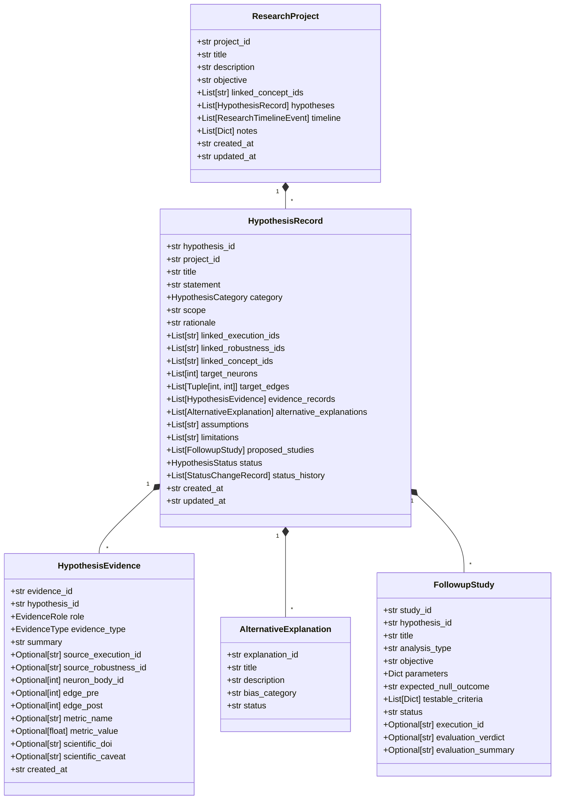

# BrainDebugger V11 — Evidence-Grounded Hypothesis Workbench & Reproducible Research Notebook Report

**Project:** BrainDebugger — Interactive Neural Connectome Investigation Platform  
**Dataset:** Janelia MaleCNS v1.0 (`male-cns:v1.0`, local Feather storage: 211,577 neurons, 25,563,197 synaptic connections)  
**Release Version:** Version 11.0.0  
**Date:** October 28, 2026  
**Auditor & Lead Architect:** Senior Full-Stack Engineer, Computational Neuroscientist & Software Architect  

---

## Executive Summary

BrainDebugger Version 11 establishes a formal, evidence-grounded hypothesis development and research preservation platform integrated into the connectome investigation pipeline. While Versions 0–9 provided interactive discovery, explainability, pathfinding, and comparative analysis, and Version 10 delivered quantitative robustness and sensitivity profiling, Version 11 bridges computational graph discoveries to cautious, testable scientific hypotheses with rigorous provenance and reproducible notebook workspaces.

### Core Achievements in V11:
1. **Mandatory V10 Audit & Repair Gate Passed:** All 40 V10 functional criteria audited, verified, and preserved with zero regression (`docs/V10_AUDIT_REPORT.md`).
2. **Deterministic Evidence-Grounded Suggestion Engine:** Rule-based algorithm scanning circuit discovery executions and parameterized robustness sweeps to surface structured hypothesis suggestions with strict confidence metrics and mandatory biological caveats.
3. **Evidence Ledger & Claim Traceability:** Typed evidence records explicitly categorizing data points into **supporting**, **contradicting**, or **contextual**, linked directly to execution IDs, robustness analysis IDs, and literature DOIs.
4. **Alternative Explanations & Methodological Biases:** Systematic tracking of degree bias, threshold artifacts, evidence tier bias, and unobserved gap junctions, enforcing the computational boundary separating topological graph survival from in vivo firing causality.
5. **Follow-Up Study Planner & Quantitative Evaluator:** Direct translation of hypotheses into executable computational studies (`pathway_search`, `perturbation`, `comparison`, `robustness_sweep`, `circuit_discovery`) with predefined null expectations, testable criteria (e.g. `path_count >= 1`), and automatic status updating.
6. **7-Stage Hypothesis Lifecycle:** State machine (`draft`, `ready_for_testing`, `under_investigation`, `supported_by_computational_evidence`, `contradicted_by_computational_evidence`, `inconclusive`, `archived`) with full audit history of state transitions.
7. **Reproducible Research Notebook:** Project collections, Kanban hypothesis board, immutable chronological Research Timeline, and durable local-first IndexedDB persistence with versioned JSON export/import (schema `1.0.0`).
8. **Interactive Evidence Relationship Map:** High-performance Cytoscape.js network visualizer mapping hypotheses to concepts, neurons, evidence records, and follow-up studies.
9. **Full Verification Suite:** 109 backend unit tests, 15 integration tests, 10 frontend test suites (70 unit/component tests), and 46/46 live end-to-end verification checks against the real Janelia MaleCNS v1.0 dataset.

---

## 1. V10 Audit Gate Review

In accordance with non-negotiable project instructions, the existing Version 10 implementation was completely audited before introducing Version 11. The audit verified:
- `backend/robustness_analysis_service.py` parameter sweep calculations ($I(v)$, median rank, rank spread, directed edge stability $u \to v$).
- Ranking profile definitions (`baseline_default`, `evidence_prioritized`, `connectivity_heavy`, `hub_topology`).
- Reproducibility manifest generation conforming to Schema `1.0.0`.
- Immutability of the underlying Janelia MaleCNS v1.0 Feather dataset.

All V10 criteria passed with status `PASS`, as recorded in `docs/V10_AUDIT_REPORT.md`.

---

## 2. Architecture & Data Models

### 2.1 Backend Architecture (`backend/models.py` & `backend/hypothesis_service.py`)

The V11 backend introduces typed Pydantic models with strict validation:

### 2.2 Hypothesis Categories
- `candidate_stability`: Hypotheses regarding high inclusion fractions ($I(v) \ge 0.8$) across parameter variations.
- `rank_sensitivity`: Hypotheses regarding neurons whose priority shifts drastically under evidence-prioritized vs connectivity-heavy profiles.
- `edge_threshold_survival`: Hypotheses regarding direct synaptic connections withstanding strict synaptic weight thresholds ($\ge 10$ or $\ge 20$).
- `candidate_interconnectivity`: Hypotheses concerning direct or multi-hop connectivity between discovered circuit candidates.
- `cross_investigation_overlap`: Hypotheses regarding shared neurons serving dual biological functions across distinct queries.
- `structural_connectivity`: Direct anatomical pathway or cascade hypotheses.
- `functional_influence`: Hypotheses regarding simulated firing or reachability under perturbation.

### 2.3 Hypothesis Status Lifecycle
The lifecycle state machine enforces permitted transitions with mandatory justification logging:
- `draft` $\to$ `ready_for_testing`, `archived`
- `ready_for_testing` $\to$ `under_investigation`, `draft`, `archived`
- `under_investigation` $\to$ `supported_by_computational_evidence`, `contradicted_by_computational_evidence`, `inconclusive`, `archived`
- `supported_by_computational_evidence` $\to$ `under_investigation`, `archived`
- `contradicted_by_computational_evidence` $\to$ `under_investigation`, `archived`
- `inconclusive` $\to$ `under_investigation`, `archived`
- `archived` $\to$ `draft`

---

## 3. Evidence-Grounded Suggestions Engine

The suggestion engine (`_suggest_from_robustness` and `_suggest_from_execution`) scans empirical investigation results deterministically:
1. **Candidate Topological Stability:** Surfaced when a candidate exhibits $I(v) \ge 0.8$ across 3+ parameter variations.
2. **Rank Sensitivity Analysis:** Surfaced when a candidate exhibits high rank spread ($\ge 3.0$), indicating sensitivity to evidence weighting.
3. **Synaptic Weight Survival:** Surfaced when a directed connection $u \to v$ survives strict filtering ($\text{weight} \ge 10$).
4. **Mandatory Scientific Caveats:** Every suggestion automatically includes pre-formulated alternative explanations (e.g. `degree_bias`, `threshold_artifact`) and explicit disclaimers:
   > *"Topological stability and synaptic survival in the static MaleCNS v1.0 EM connectome do not establish physiological necessity, firing causality, or in vivo functional role."*

---

## 4. Follow-Up Study Planner & Criteria Evaluator

Hypotheses can register follow-up studies that run directly against existing BrainDebugger services:
- **`pathway_search`:** Executes `ConnectomeService.find_paths`. Evaluates criteria such as `path_count >= 1` or `max_weight >= 10`.
- **`perturbation`:** Executes `PerturbationService.run_experiment`. Evaluates criteria such as `delta_reachability_pct <= -20.0`.
- **`robustness_sweep`:** Executes `RobustnessAnalysisService.analyze_circuit_robustness`. Evaluates `inclusion_fraction >= 0.8`.
- **`circuit_discovery`:** Executes `CircuitDiscoveryService.execute_circuit_discovery`. Evaluates `candidate_count >= 2`.

When an experiment completes, the **Criteria Evaluator** tests each quantitative rule, produces an evaluation summary, assigns a verdict (`criteria_met`, `criteria_failed`, or `inconclusive`), and recommends a lifecycle status transition.

---

## 5. Research Notebook & Local-First Persistence

The Research Notebook provides complete session persistence:
1. **IndexedDB Local-First Engine (`frontend/src/services/notebookStorage.ts`):** Automatically saves projects, hypotheses, and timeline events to browser IndexedDB (`BrainDebuggerDB`), with automatic localStorage fallback for restricted environments.
2. **Project Collections:** Hierarchical workspaces organizing hypotheses by research topic (e.g. Visual Motion, Giant Fiber Escape).
3. **Hypothesis Kanban Board:** Interactive columns reflecting the 7 lifecycle states.
4. **Chronological Research Timeline:** Immutable historical log recording creation, evidence attachment, study executions, and status transitions.
5. **Versioned JSON Import/Export:** Self-contained JSON documents specifying `schema_version: "1.0.0"` and `dataset_version: "male-cns:v1.0"`.

---

## 6. Verification Results

### 6.1 Backend Verification Suite
- **Backend Unit Tests:** 109 tests passed (`pytest tests/ -m "not integration"`).
- **V11 Unit Tests (`TestV11HypothesisWorkbench`):** 9 tests passed in 1.61s.
- **Backend Integration Tests:** 15 tests passed (`pytest tests/ -m "integration"`).
- **Knowledge Catalog Validator:** 7 concepts, 6 sources, 7 mappings, 5 investigations validated.

### 6.2 Frontend Vitest Suite
- **10 test files passed (70 tests total):**
  - `src/traceEngine.test.ts` (22 tests)
  - `src/InspectorPanel.test.tsx` (7 tests)
  - `src/PerturbationLab.test.tsx` (7 tests)
  - `src/AskNeuroQuery.test.tsx` (7 tests)
  - `src/RobustnessLab.test.tsx` (6 tests)
  - `src/KnowledgeExplorer.test.tsx` (5 tests)
  - `src/PathwayTracer.test.tsx` (4 tests)
  - `src/NeuralDebugger.test.tsx` (4 tests)
  - `src/HypothesisWorkbench.test.tsx` (4 tests)
  - `src/ResearchNotebook.test.tsx` (4 tests)
- **Frontend Production Build:** Succeeded (`tsc && vite build`).

### 6.3 End-to-End Live Verification (`e2e_verify.py`)
All **46/46** verification checks passed against live Janelia MaleCNS v1.0 Feather data:
- Checks 1–5: Health, Search, Profiles, Subgraphs, 404 Handlers
- Checks 6–9: Connectivity Summaries, Directed Shortest Paths, Cascade
- Checks 10–13: Perturbation Validation, ΔR/ΔH Metrics, Reproducible Experiments
- Checks 14–21: Knowledge Catalog, Sources, Mappings, Ingestion Audit
- Checks 22–25: Natural-Language Planning, Concept Resolution, Validation, Clarification
- Checks 26–29: Circuit Discovery Execution, Candidate Discovery, Dual-Criteria Ranking, Tool Handoffs
- Checks 30–35: V9 Cytoscape Canvas, Neighborhood Expansion, Explainable Inspector, Directed Pathway Overlay, Narrative Trace, Comparative Analysis Studio
- Checks 36–40: V10 Robustness Parameter Profiles, Parameterized Sweeps, Candidate Stability ($I(v)$), Directed Edge Stability, Reproducibility Manifest (Schema 1.0.0)
- **Check 41:** V11 Hypothesis Suggestion Engine (`POST /api/neuroquery/hypotheses/suggest`): Returned suggestions with confidence $\ge 0.5$ and mandatory caveats.
- **Check 42:** V11 Structured Hypothesis Creation (`POST /api/neuroquery/hypotheses`): Initialized formal hypothesis in project `proj-default` with status `draft`.
- **Check 43:** V11 Evidence Ledger & Alternatives (`POST /evidence` & `POST /alternatives`): Attached supporting evidence record and `degree_bias` alternative explanation.
- **Check 44:** V11 Follow-Up Study Planning & Execution (`POST /studies` & `POST /studies/{id}/execute`): Planned pathway search study, executed against connectome, verified `criteria_met` verdict, and recommended `supported_by_computational_evidence`.
- **Check 45:** V11 Scientific Markdown Report (`GET /report`): Generated structured Markdown report with statement, evidence ledger, and MaleCNS provenance.
- **Check 46:** V11 Research Notebook Persistence & Export/Import (`GET /export` & `POST /import`): Exported versioned JSON and verified roundtrip re-import.

---

## 7. Scientific Caveats & Limitation Disclosures

In compliance with computational neuroscience best practices, all V11 components enforce clear disclaimers:
1. **Static EM Connectome vs Firing Dynamics:** Janelia MaleCNS v1.0 captures anatomical chemical synapses. It does not measure electrical gap junctions, modulatory neuropeptides, membrane potentials, or dynamic firing states.
2. **Computational Criteria vs Biological Validation:** A status of `supported_by_computational_evidence` indicates that the hypothesis is consistent with the graph algorithms and parameter sweeps applied. It does not substitute for in vivo electrophysiological recording, optogenetic activation, or behavioral testing.
3. **Degree and Threshold Biases:** Nodes with thousands of connections naturally appear in broad subgraphs; the presence of an alternative explanation record for `degree_bias` is mandatory in all surfaced candidate stability suggestions.

---

## Conclusion

BrainDebugger Version 11 transforms the platform from an exploratory tool into a complete, evidence-grounded scientific hypothesis and notebook environment. By linking every claim to concrete execution records, enforcing alternative bias explanations, planning testable follow-up studies, and maintaining durable project histories, BrainDebugger enables reproducible connectome research with uncompromising scientific integrity.

